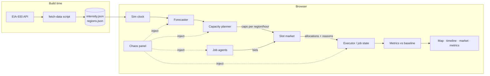

# Sunchaser: A Carbon-Aware Compute Shifter

**Status:** Draft v1 · **Date:** 2026-10-27 · **Audience:** software engineers who are new to grid and energy concepts.
**Purpose:** This doc drives (a) a ~24h example implementation and (b) a slide deck. Sections marked **[Next step]** are out of scope for the 24h build.

---

## 1. Summary

Electricity is cleaner and cheaper in different places at different times. For example, California is solar-heavy at noon, and the Pacific Northwest runs on hydro. Many AI jobs, such as training, batch inference and evals, are flexible: they don't care *when* they run or *where*, within limits.

Sunchaser has two layers:

1. **Capacity planner (supply side).** It turns carbon forecasts into **hourly compute caps per region**. This is the same shape as Google's carbon-aware system: it doesn't place jobs, it shapes how much flexible capacity exists in each region and hour.
2. **Slot market (demand side).** Each job is an **agent** with a budget, a deadline and a carbon target. Agents **bid** for the capacity the planner opened. The market clears every hour and records *why* each job won or lost.

A **responsive web app** shows a live map, the market and the carbon saved against a baseline. It also lets the viewer act as a **chaos monkey**: bust a forecast, kill a region, flood the queue or trigger a demand-response event, and then watch the system recover.

The prompt's three ideas map onto one system:

| Prompt idea | Sunchaser component |
|---|---|
| Live map of where to train right now | Map plus a per-region intensity timeline |
| Job router that shows carbon saved | Planner, market and baseline comparison |
| Agents that bid for the cleanest slots | Slot market |

## 2. Goals and non-goals

**Goals (24h build)**
- Use real grid data, specifically EIA hourly generation by fuel for 5 US regions.
- Make the simulation deterministic and replayable, with a seeded RNG and an event log.
- Show the carbon saved compared with a naive baseline.
- Explain every allocation: why this job, why this region, why this hour.
- Provide chaos-monkey controls whose effects are visible within seconds.
- Run as a static site that works on a phone.

**Non-goals**
- Real cluster integration. The system emits caps and allocations; it does not run actual jobs.
- Real-time prices (LMP) or marginal-emissions data. These are **[Next step]**.
- Multi-tenant auth or persistence beyond the browser.

## 3. Glossary (for the non-energy reader)

| Term | Meaning |
|---|---|
| **Carbon intensity** | gCO₂ emitted per kWh consumed. Lower is cleaner. |
| **Average vs marginal intensity** | *Average* is the emissions of the whole current generation mix. *Marginal* is the emissions of the next kWh, which usually comes from a gas or coal plant ramping up. The two can **rank hours differently** (see §8.4). |
| **Balancing Authority (BA)** | The grid operator for a region, e.g. CISO (California) or ERCO (Texas). EIA reports data per BA. |
| **Demand response (DR)** | The grid asks big consumers to cut load during stress. Flexible compute is an ideal DR resource. |
| **Flexible vs inflexible load** | Inflexible load is serving traffic and must run now. Flexible load is batch work with slack before its deadline. |
| **Slack** | Time to deadline minus remaining runtime. Zero slack means the job must run now. |

## 4. Architecture

Everything runs in the browser. A build-time script snapshots real data into JSON, so the demo never depends on a live API.



**Stack:** TypeScript, Vite and React, with Leaflet (or react-simple-maps) for the map and Recharts for charts. The sim engine is a pure TS module with no UI imports, so it can be unit tested and run headless for the "carbon saved" numbers on the slides. It deploys as a static site.

**Tick:** 1 sim hour per tick. The clock is adjustable from 0.5 to 5 s per tick, and the sim replays a historical 7-day window.

## 5. Data

**Source:** EIA-930 Hourly Electric Grid Monitor (API v2, `electricity/rto/fuel-type-data`). It gives hourly net generation per BA by fuel. The API key is free.

**Intensity** = Σ(generation_fuel × factor_fuel) / Σ generation. The factors are IPCC AR5 lifecycle medians in gCO₂/kWh:

| COL | NG | OIL | NUC | WAT | WND | SUN | OTH |
|---|---|---|---|---|---|---|---|
| 820 | 490 | 650* | 12 | 24 | 11 | 45 | 230* |

\* Rough placeholder values. They are a small share of generation in the chosen regions.

**Regions:** 5 regions chosen for diverse behavior. Each region is mapped to a well-known data-center town so the map has pins.

| BA | Pin | Character |
|---|---|---|
| BPAT | The Dalles, OR | Hydro, cleanest, flat |
| CISO | San Jose, CA | Solar "duck curve": clean midday, dirty evening |
| SWPP | Pryor, OK | Wind: volatile, clean at night |
| ERCO | Dallas, TX | Wind, solar and gas mix |
| PJM | Ashburn, VA | Gas, coal and nuclear; dirtiest, biggest |

**Price:** a static $/MWh per region with a simple time-of-use multiplier. Real LMP data is **[Next step]**.

**Forecasts (demo mode):** forecast = actual future value + noise, where σ grows with horizon (≈ 3% × √h). This is honest about what it is: a synthetic forecast built on real actuals. A real forecast from Open-Meteo wind and solar data plus installed capacity is **[Next step]**.

**Jobs:** a synthetic generator whose shape is loosely based on public cluster traces: a heavy-tailed size distribution, a diurnal arrival pattern, and a mix of roughly 70% flexible and 30% urgent jobs.

## 6. Core model

```ts
type RegionId = 'BPAT' | 'CISO' | 'SWPP' | 'ERCO' | 'PJM';

interface Region {
  id: RegionId;
  gpuCapacity: number;          // total GPUs
  inflexibleLoad: number[];     // GPUs reserved per hour (serving traffic)
  powerCapMW: number;           // contract/power limit
  pricePerMWh: number;
}

interface Slot { region: RegionId; hour: number; cap: number; reservePrice: number; forecastIntensity: number; }

interface Job {
  id: string;
  workGpuH: number;  remainingGpuH: number;
  maxGpus: number;              // parallelism limit
  arrival: number;  deadline: number;          // sim hours
  budgetUsd: number;  carbonTargetG: number;   // gCO2/kWh it prefers to stay under
  homeRegion: RegionId;  allowedRegions: RegionId[];   // data residency
  dataGB: number;               // input size → move cost
  state: 'queued' | 'running' | 'paused' | 'moving' | 'done' | 'missed';
  log: Decision[];              // explainability
}
```

**Energy model:** 1 GPU-hour ≈ 0.85 kWh at the wall, including PUE (H100 700 W × 1.2). Carbon = kWh × actual intensity. Plans use *forecast* intensity; scoring always uses *actual* intensity.

## 7. Control loop (each sim hour)

1. **Observe.** Reveal the actual intensity for hour *t*, and refresh forecasts for t+1 … t+48.
2. **Plan.** Every hour, the planner recomputes caps for the next 48h. This is a receding horizon: only hour *t* is committed, and the rest is re-planned. (§8)
3. **Bid.** Each active agent submits bids for hour-*t* slots in its allowed regions. (§9)
4. **Clear.** Each region runs a uniform-price auction up to `cap[r,t]`.
5. **Execute.** Winners run for 1h, and jobs checkpoint at the hour boundary. Losers wait. Jobs that switched region enter `moving` and pay the move cost. (§10)
6. **Score.** Accumulate kWh, CO₂, $ and deadline misses, for both Sunchaser and the baseline.

## 8. Deep dive: turning forecasts into capacity caps

This is the part specific to carbon-aware scheduling, and the main technical story for the deck.

### 8.1 Algorithm: deadline-constrained water-filling

**Inputs:**
- Forecast intensity `I[r,h]`
- Free capacity `free[r,h] = min(gpuCapacity − inflexibleLoad[h], powerCap-derived GPUs)`
- The outstanding flexible work, grouped by deadline

**Steps:**
1. Sort all (r, h) slots in the horizon by `I[r,h]`, cleanest first.
2. **Deadline pass (feasibility first).** For each deadline *d*, in ascending order, check the cumulative condition: Σ caps in slots before *d* must be ≥ Σ work due by *d*. If the condition fails, open the cleanest still-closed slots before *d* until it holds. This guarantees that a plan exists in which every job finishes, which an earliest-deadline-first (EDF) feasibility argument confirms.
3. **Carbon pass.** Spend any remaining required capacity on the globally cleanest open slots.
4. **Safety margin.** Inflate total opened capacity by `(1 + m)`. *m* grows with forecast error seen so far and with backlog, starting at 10%.
5. **Damping.** Limit `|cap[r,h] − previousPlan[r,h]|` to Δ per replan, and limit hour-to-hour cap change to avoid sharp ramps (hysteresis).
6. **Reserve price.** `reservePrice[r,h] = energyPrice + carbonPrice × I[r,h]`. This makes dirty slots expensive even when they are open.

The algorithm is a greedy heuristic, so it is explainable and fast. An LP or MILP formulation is **[Next step]**. The greedy plan is a good slide because each step maps to one pitfall.

### 8.2 Pitfalls and how the design handles them

| Pitfall | Mechanism |
|---|---|
| Forecast error leaves work undone | Receding-horizon replan every hour, plus a safety margin *m* that adapts to observed error |
| Backlog grows anyway | **Fallback:** if backlog > *X* hours of capacity, caps relax toward `free[r,h]` (carbon-blind) until the backlog drains. This is logged as a "degraded" event. |
| Starvation (a job postponed forever) | **Deadline escape hatch:** a job with slack ≤ 1h becomes *must-run*. It bypasses caps and bids with maximum priority. Its bids also rise as slack shrinks (§9). |
| Caps exceed power or contract limits | `free[r,h]` already includes the power cap. The planner never opens past it. |
| Herd effect (everyone piles into BPAT) | Caps act as per-region quotas, and damping prevents swings. The chaos panel can turn damping off to show the oscillation. |

### 8.3 Interesting nuance for the deck: the planner and the market disagree on purpose

The planner optimizes **system carbon**. Agents optimize **their own utility**. The reserve price is the bridge: it puts carbon into the price an agent sees. One knob, `carbonPrice` in $/tCO₂, trades cost against carbon, and the UI exposes it as a slider.

### 8.4 Second nuance: average vs marginal intensity

In CISO, a midday hour has low *average* intensity because of solar. But if solar is being curtailed, the *marginal* kWh is effectively free and clean. In the evening, the marginal kWh comes from a gas peaker even though the average still looks moderate. Ranking hours by average intensity understates the value of moving load *off* the evening peak. The demo uses average intensity, because that is what EIA provides. The deck calls this out, and a marginal signal (e.g. WattTime) is **[Next step]**.

## 9. Slot market: agents that bid

**Agent bid for slot (r, t):**
```
urgency   = remainingGpuH / (maxGpus × hoursToDeadline)          // 0..1+, 1 = must run continuously
value     = baseValue × (1 + k × urgency²)                       // bids rise as deadline nears
carbonOK  = I[r,t] ≤ carbonTargetG  ||  urgency > 0.8            // relax target when urgent
moveOK    = r == current  ||  carbonSaved(r) > moveCost(dataGB)  // §10
bid       = carbonOK && moveOK && value ≥ reservePrice ? min(value, budgetLeft/remaining) : none
```
Each agent bids for `min(maxGpus, remainingGpuH)` GPUs in its single best region, choosing the region with the best value net of price. One bid per agent per hour keeps clearing simple.

**Clearing:** each region sorts bids by price and fills `cap[r,t]`. Every winner pays the **clearing price**, which is the highest losing bid or the reserve price if there was no losing bid. This uniform-price design means agents' best strategy is roughly to bid their true value.

**Explainability:** every decision appends a `Decision` record to the job's log, for example:
`t=31 PJM: skipped (I=540 > target 300, urgency 0.2)` or `t=34 BPAT: won 8 GPUs @ $1.92 (clearing), outbid job-17`. The UI shows these logs.

## 10. Cross-region moves (lightweight)

- **Move cost:** extra kWh ≈ `dataGB × e_transfer` plus a delay of `dataGB / bandwidth` hours. Both are tunable assumptions. An agent moves only if the forecast carbon saved over its remaining work exceeds that cost.
- **Data residency:** `allowedRegions` is a hard filter. Some generated jobs are pinned, e.g. to a region with EU-style rules.
- **Herd effect:** handled by caps and damping (§8.2).

## 11. Job lifecycle

```
queued → running ⇄ paused → done
            ↓ ↑
          moving            (any) → missed  (deadline passed)
```
- Jobs checkpoint at every hour boundary, so preemption loses no work. Non-checkpointable jobs that need contiguous runs are **[Next step]**.
- Work is accounted per job-hour with an idempotent key `(jobId, hour)`, so replays and preemptions can't double-count.
- **Lateness view:** every job shows its slack, its projected finish time and the carbon it has used. This answers "how late is my job, and why?"

## 12. Chaos monkey

Each control injects an event, and the UI highlights the system's response.

| Chaos control | What it does | Expected response |
|---|---|---|
| **Forecast bust** | Actual intensity in region R is +40% for 6h ("wind died") | Next replan shifts caps away from R. *m* grows. Some carbon is lost, which is shown. |
| **Region outage** | Capacity in R drops to 0 | Agents re-bid elsewhere. Pinned jobs wait, may miss deadlines, and are flagged. |
| **Demand-response event** | Grid asks R to shed 50% flexible load for 3h | Caps in R are cut immediately. Work shifts or waits. Counted as "DR MWh delivered". (The partner's 2025 report cites 360+ DR events.) |
| **Job flood** | 50 urgent jobs arrive | Backlog fallback relaxes caps. The carbon cost of urgency is visible. |
| **Stale data feed** | Forecast stops updating | Planner holds the last forecast and widens *m*. A "degraded" badge appears. |
| **Deadline crunch** | Halves all remaining deadlines | Escape hatch fires and bids spike. Carbon savings drop and the UI shows why. |
| **Damping off** | Disables hysteresis and quotas | Herd oscillation becomes visible on the timeline. |
| **Carbon price slider** | $0 → $300/tCO₂ | Cost-vs-carbon trade-off, live |

Chaos events go into the seeded event log, so "replay this run" reproduces the same result.

## 13. Metrics and baseline

**Baseline:** the same job stream, run **as soon as possible in the home region** (FIFO, with no caps and no moves).

**Headline tiles:**
- **CO₂ saved** (kg and %)
- **$ delta**
- **Deadline misses** (Sunchaser vs baseline)
- **Avg delay** per job
- **Clean-energy share**
- **DR MWh delivered**

**Headless run:** `npm run sim -- --seed 1 --days 7` prints the headline numbers for the slides.

## 14. UI (responsive)

- **Map:** region pins colored by current intensity, sized by running GPUs. Arrows show jobs moving between regions.
- **Timeline:** per-region intensity, both forecast and actual, overlaid with caps and usage. This is the key chart for the planner story.
- **Market panel:** the current hour's bids and the clearing price per region. Clicking a job opens its decision log.
- **Metrics tiles:** Sunchaser vs baseline.
- **Chaos drawer:** buttons and sliders. On mobile, the layout stacks as map → tiles → chaos → timeline.

## 15. 24h build plan

| # | Block | Est. | Cut line |
|---|---|---|---|
| 1 | Data fetch script, intensity calc, JSON snapshot | 2h | Must |
| 2 | Sim core: clock, regions, jobs generator, executor, baseline, metrics | 4h | Must |
| 3 | Planner: water-filling, deadline pass, margin, damping | 3h | Must |
| 4 | Market: bids, clearing, decision log | 3h | Must |
| 5 | UI shell, map, metrics tiles, timeline | 4h | Must |
| 6 | Chaos controls: bust, outage, DR, flood | 2h | Must |
| 7 | Market panel, job log, move arrows | 2h | Should |
| 8 | Stale feed, deadline crunch, damping toggle, carbon-price slider | 1.5h | Should |
| 9 | Headless runner and slide numbers | 1h | Should |
| 10 | Deploy and polish | 1.5h | Must |

That totals about 24h. If time runs short, cut #7 and #8 first. Simplest fallback for the market: replace it with "cleanest open slot, EDF order". That keeps the planner story intact.

## 16. Next steps (for the deck)

1. Marginal emissions signal (WattTime) and real LMP prices
2. Real forecasts from Open-Meteo wind and solar plus installed capacity, or the EIA day-ahead forecast
3. LP or MILP planner with a formal deadline guarantee, compared against the greedy plan
4. Non-checkpointable and gang-scheduled jobs, plus richer data-gravity modeling
5. Integration with a real scheduler (Kubernetes / Slurm) as an admission controller that enforces caps
6. Fleet DR participation: bidding flexible compute into grid DR programs as a revenue source
7. Global regions, e.g. via Electricity Maps, for true follow-the-sun across time zones

## 17. Risks and open questions

- **EIA data gaps.** EIA-930 has occasional missing or negative values. Plan: interpolate and flag. Pick a clean 7-day window at fetch time.
- **Synthetic forecasts and synthetic jobs** could make savings look better than reality. Plan: state this on the slides, and show a sensitivity check with forecast noise increased.
- **Open question:** should the deck lead with the planner (technical depth) or the chaos demo (engagement)? Suggestion: open with the demo, then go deep on the planner.
