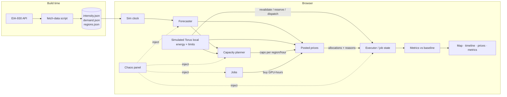

# Sunchaser: A Carbon-Aware Compute Shifter

**Status:** Draft v2.0 · **Date:** 2026-10-27 · **Audience:** software engineers who are new to grid and energy concepts.
**Purpose:** This doc drives (a) a ~24h example implementation and (b) a slide deck. Sections marked **[Next step]** are out of scope for the 24h build.

## What changed in 2.0

v1 had jobs **bid in an auction** for capacity. That was hard to explain and hard to build. v2.0 replaces the auction with **posted prices**, which is how electricity tariffs and cloud spot instances already work:

| v1 (auction) | v2.0 (posted price) |
|---|---|
| Agents compute a bid from urgency, value, budget and carbon target | Each region posts one price per hour. Jobs just read it. |
| Uniform-price clearing; price depends on other jobs' bids | Price depends only on the grid: how busy it is and how dirty it is |
| Ties broken by who bids highest | When a region is full, the earliest deadline goes first |
| Per-job `budgetUsd` and `carbonTargetG` | Removed. Carbon is already inside the price. |

**The realism we keep:** power really is cheaper when the grid has spare capacity (low demand, lots of wind or solar) and pricier when it is stressed. Sunchaser prices compute off real hourly grid demand and real carbon intensity, so jobs "chase" the same signals a real operator would.

Changed sections: §1, §3, §4, §5, §6, §7, §8.1, §8.2, §8.3, **§9 (rewritten)**, §12, §13 (only two headline tiles), §14 (no separate price-board panel; prices live on pins, timeline strips and the job card), §15, §16.

---

## 1. Summary

Electricity is cleaner and cheaper in different places at different times. For example, California is solar-heavy at noon, and the Pacific Northwest runs on hydro. Many AI jobs, such as training, batch inference and evals, are flexible: they don't care *when* they run or *where*, within limits.

**Torus integration:** use the same planner and posted-price flow with simulated local solar/storage, fixed load, protected reserves and utility import limits. Two Utah sites can share the PACE regional signal but have different usable energy. EIA supplies regional context; local inputs are labeled simulations, without Lasso access.

Sunchaser has two layers:

1. **Capacity planner (supply side).** It turns carbon forecasts into **hourly compute caps per region**. This is the same shape as Google's carbon-aware system: it doesn't place jobs, it shapes how much flexible capacity exists in each region and hour.
2. **Posted prices (demand side).** Every region posts a **price per GPU-hour** for each hour. The price goes up when the local grid is busy or dirty. Each job is a simple shopper: it runs in the hours that are cheapest for it while still meeting its deadline. Every choice is logged with a reason.

A **responsive web app** shows a live map with current prices, a timeline of what's coming and the carbon saved against a baseline. It also lets the viewer act as a **chaos monkey**: bust a forecast, kill a region, flood the queue or trigger a demand-response event, and then watch the system recover.

The prompt's three ideas map onto one system:

| Prompt idea | Sunchaser component |
|---|---|
| Live map of where to train right now | Map plus a per-region intensity timeline |
| Job router that shows carbon saved | Planner, posted prices and baseline comparison |
| Agents that bid for the cleanest slots | Jobs choosing eligible posted-price slots; the rubric checks this capability without requiring an auction |

## 2. Goals and non-goals

**Goals (24h build)**
- Use real grid data, specifically EIA hourly generation by fuel and hourly demand for 5 US regions.
- Make the simulation deterministic and replayable, with a seeded RNG and an event log.
- Show the carbon saved compared with a naive baseline.
- Explain every allocation: why this job, why this region, why this hour.
- Provide chaos-monkey controls whose effects are visible within seconds.
- Run as a static site that works on a phone.

**Non-goals**
- Real cluster integration. The system emits caps and allocations; it does not run actual jobs.
- Real-time wholesale prices (LMP) or marginal-emissions data. These are **[Next step]**.
- Auctions or any price that reacts to job demand. Jobs are price-takers. **[Next step]**
- Multi-tenant auth or persistence beyond the browser.

## 3. Glossary (for the non-energy reader)

| Term | Meaning |
|---|---|
| **Carbon intensity** | gCO₂ emitted per kWh consumed. Lower is cleaner. |
| **Average vs marginal intensity** | *Average* is the emissions of the whole current generation mix. *Marginal* is the emissions of the next kWh, which usually comes from a gas or coal plant ramping up. The two can **rank hours differently** (see §8.4). |
| **Balancing Authority (BA)** | The grid operator for a region, e.g. CISO (California) or ERCO (Texas). EIA reports data per BA. |
| **Grid demand / load** | Total power customers in a BA are drawing this hour. High demand means the grid is stressed and expensive plants are running. |
| **Posted price** | A price announced up front that everyone pays. No bidding, like a time-of-use electricity tariff. |
| **Demand response (DR)** | The grid asks big consumers to cut load during stress. Flexible compute is an ideal DR resource. |
| **Flexible vs inflexible load** | Inflexible load is serving traffic and must run now. Flexible load is batch work with slack before its deadline. |
| **Slack** | Time to deadline minus remaining runtime. Zero slack means the job must run now. |

## 4. Architecture

Everything runs in the browser. A build-time script snapshots real data into JSON, so the demo never depends on a live API.



**Stack:** TypeScript, Vite and React, with Leaflet (or react-simple-maps) for the map and Recharts for charts. The sim engine is a pure TS module with no UI imports, so it can be unit tested and run headless for the "carbon saved" numbers on the slides. It deploys as a static site.

**Tick:** 1 sim hour per tick. The clock is adjustable from 0.5 to 5 s per tick, and the sim replays a historical 7-day window.

## 5. Data

**Source:** EIA-930 Hourly Electric Grid Monitor (API v2). The API key is free. Two endpoints:
- `electricity/rto/fuel-type-data`: hourly net generation per BA by fuel → carbon intensity.
- `electricity/rto/region-data` (type `D`): hourly demand per BA → price.

**Intensity** = Σ(generation_fuel × factor_fuel) / Σ generation. This is a generation-weighted lifecycle proxy in gCO₂e/kWh, not consumption or marginal emissions. Factors use IPCC AR5 lifecycle medians:

| COL | NG | OIL | NUC | WAT | WND | SUN | OTH |
|---|---|---|---|---|---|---|---|
| 820 | 490 | 650* | 12 | 24 | 11 | 45 | 230* |

\* Rough placeholder values. They are a small share of generation in the chosen regions.

**Regions:** 5 regions chosen for diverse behavior. Each region is mapped to a well-known data-center town so the map has pins.

| BA | Pin | Character | Base energy price |
|---|---|---|---|
| BPAT | The Dalles, OR | Hydro, cleanest, flat | $40/MWh |
| CISO | San Jose, CA | Solar "duck curve": clean midday, dirty evening | $60/MWh |
| SWPP | Pryor, OK | Wind: volatile, clean at night | $35/MWh |
| ERCO | Dallas, TX | Wind, solar and gas mix | $45/MWh |
| PJM | Ashburn, VA | Gas, coal and nuclear; dirtiest, biggest | $50/MWh |

Base prices are tunable simulation assumptions, not observed tariffs or wholesale quotes.

**Price:** see §9. In short: base price, scaled by how busy the grid is this hour (real EIA demand), plus a carbon charge. Real LMP data is **[Next step]**.

**Forecasts (demo mode):** forecast = actual future value + noise, where σ grows with horizon (≈ 3% × √h). This applies to both intensity and demand. This is honest about what it is: a synthetic forecast built on real actuals. A real forecast from Open-Meteo wind and solar data plus installed capacity is **[Next step]**.

**Jobs:** a synthetic generator whose shape is loosely based on public cluster traces: a heavy-tailed size distribution, a diurnal arrival pattern, and a mix of roughly 70% flexible and 30% urgent jobs.

## 6. Core model

The regional sketch below remains useful for the multi-region demo. Torus sites use the site-level contracts in `src/core/energy/` and `src/core/scheduling/`; local storage, reserve and utility limits constrain their slots independently.

```ts
type RegionId = 'BPAT' | 'CISO' | 'SWPP' | 'ERCO' | 'PJM';

interface Region {
  id: RegionId;
  gpuCapacity: number;          // total GPUs
  inflexibleLoad: number[];     // GPUs reserved per hour (serving traffic)
  powerCapMW: number;           // contract/power limit
  basePricePerMWh: number;      // §5 table
  avgDemandMW: number;          // mean grid demand over the data window
}

interface Slot {
  region: RegionId; hour: number;
  cap: number;                  // GPUs the planner opened (§8)
  used: number;                 // GPUs sold so far this hour
  pricePerGpuH: number;         // posted price (§9)
  forecastIntensity: number;
}

interface Job {
  id: string;
  workGpuH: number;  remainingGpuH: number;
  maxGpus: number;              // parallelism limit
  arrival: number;  deadline: number;          // sim hours
  homeRegion: RegionId;  allowedRegions: RegionId[];   // data residency
  currentRegion: RegionId;
  dataGB: number;               // input size → move cost
  state: 'queued' | 'running' | 'paused' | 'moving' | 'done' | 'missed';
  log: Decision[];              // explainability
}
```

**Energy model:** 1 GPU-hour ≈ 0.85 kWh at the wall, including PUE (H100 700 W × 1.2). Carbon = kWh × actual intensity. Plans and prices use *forecast* values; scoring always uses *actual* values.

For Torus slots, one local ledger accounts for solar, fixed load, storage efficiency/SOC and reservations across hours. Protected energy and utility commitments are unavailable to flexible compute. Selection completes no work; execution rechecks the slot version and reserves capacity atomically. Use the same declared carbon basis for grid, local energy and transfer accounting.

## 7. Control loop (each sim hour)

1. **Observe.** Reveal the actual intensity and demand for hour *t*, and refresh forecasts for t+1 … t+48.
2. **Plan.** Every hour, the planner recomputes caps for the next 48h. This is a receding horizon: only hour *t* is committed, and the rest is re-planned. (§8)
3. **Post prices.** Each region posts a price per GPU-hour for every hour in the horizon. Hour *t* is final; later hours are forecasts. (§9)
4. **Shop.** Jobs, in earliest-deadline order, decide whether to buy hour *t* and where, until each region's cap is used up. (§9)
5. **Execute.** Buyers run for 1h, and jobs checkpoint at the hour boundary. Everyone else waits. Jobs that switched region enter `moving` and pay the move cost. (§10)
6. **Score.** Accumulate kWh, CO₂, $ and deadline misses, for both Sunchaser and the baseline.

## 8. Deep dive: turning forecasts into capacity caps

This is the part specific to carbon-aware scheduling, and the main technical story for the deck.

### 8.1 Algorithm: deadline-constrained water-filling

**Inputs:**
- Forecast intensity `I[r,h]`
- Free capacity `free[r,h] = min(gpuCapacity − inflexibleLoad[h], powerCap-derived GPUs)`, further bounded by usable local energy, reserves and utility limits at Torus sites
- The outstanding flexible work, grouped by deadline

**Steps:**
1. Sort all (r, h) slots in the horizon by `I[r,h]`, cleanest first.
2. **Deadline pass (feasibility first).** For each deadline *d*, in ascending order, check the cumulative condition: Σ caps in slots before *d* must be ≥ Σ work due by *d*. If the condition fails, open the cleanest still-closed slots before *d* until it holds. This aggregate check alone does not guarantee completion: also check each job's eligible sites, parallelism and transfer/readiness time against shared capacity. The greedy plan remains a heuristic.
3. **Carbon pass.** Spend any remaining required capacity on the globally cleanest open slots.
4. **Safety margin.** Inflate total opened capacity by `(1 + m)`. *m* grows with forecast error seen so far and with backlog, starting at 10%.
5. **Damping.** Limit `|cap[r,h] − previousPlan[r,h]|` to Δ per replan, and limit hour-to-hour cap change to avoid sharp ramps (hysteresis).

The planner decides *how much* capacity exists. It does not set prices; posted prices (§9) come from grid conditions. The algorithm is a greedy heuristic, so it is explainable and fast. An LP or MILP formulation is **[Next step]**. The greedy plan is a good slide because each step maps to one pitfall.

### 8.2 Pitfalls and how the design handles them

| Pitfall | Mechanism |
|---|---|
| Forecast error leaves work undone | Receding-horizon replan every hour, plus a safety margin *m* that adapts to observed error |
| Backlog grows anyway | **Fallback:** if backlog > *X* hours of capacity, caps relax toward `free[r,h]` (carbon-blind) until the backlog drains. This is logged as a "degraded" event. |
| Starvation (a job postponed forever) | **Deadline escape hatch:** slack ≤ 1h removes price-based waiting and may relax soft planning caps. Physical capacity, protected energy, readiness and DR/utility limits remain hard. |
| Caps exceed power or contract limits | `free[r,h]` already includes the power cap. The planner never opens past it. |
| Herd effect (everyone piles into BPAT) | Caps act as per-region quotas, so a cheap region simply sells out and later jobs go to the next-cheapest. Damping prevents swings. The chaos panel can turn damping off to show the oscillation. |

### 8.3 Interesting nuance for the deck: two signals, one knob

The planner looks at **carbon only** and decides how much capacity to open. Jobs look at **price only** and decide when to run. The price includes a carbon charge, so both point the same way. One knob, `carbonPrice` in $/tCO₂, sets how much carbon matters to jobs. The UI exposes it as a slider: at $0, jobs chase cheap-but-dirty hours (e.g. SWPP at 3am on gas); at $300, clean hours win almost every time.

### 8.4 Second nuance: average vs marginal intensity

In CISO, a midday hour has low *average* intensity because of solar. But if solar is being curtailed, the *marginal* kWh is effectively free and clean. In the evening, the marginal kWh comes from a gas peaker even though the average still looks moderate. Ranking hours by average intensity understates the value of moving load *off* the evening peak. The demo uses average intensity, because that is what EIA provides. The deck calls this out, and a marginal signal (e.g. WattTime) is **[Next step]**.

## 9. Posted prices: how jobs buy compute

### 9.1 The price

Each region posts one price per hour. It has two parts, both driven by the real grid:

```
gridLoad[r,h]    = demand[r,h] / avgDemand[r]                    // ~0.7 at night, ~1.3 at peak
energy$[r,h]     = basePrice[r] × gridLoad[r,h]                  // $/MWh: busier grid → pricier
carbon$[r,h]     = carbonPrice × I[r,h] / 1000                   // $/MWh  ($/tCO2 × gCO2/kWh / 1000)
price[r,h]       = 0.85 × (energy$ + carbon$) / 1000             // $ per GPU-hour (0.85 kWh)
```

We price only the part of compute cost that **varies**: energy and carbon. The GPU rental itself costs the same in every region and hour, so it is left out.

For Torus sites, adjust the posted rate using the ledger's expected local/grid energy mix over the full remaining posted capacity, including storage provenance/losses. Refresh the slot version as capacity is reserved; one cheap solar GPU-hour must not price a larger grid-powered allocation. Posted rates guide scheduling; realized meters determine the comparison.

**Example at 18:00 PT, carbonPrice = $100/tCO₂:**

| Region | Grid load | Intensity | Energy $/MWh | Carbon $/MWh | **$/GPU-h** |
|---|---|---|---|---|---|
| BPAT | 1.05 | 38 | 42 | 4 | **$0.039** |
| CISO | 1.30 (evening peak) | 310 | 78 | 31 | **$0.093** |
| SWPP | 0.95 | 410 | 33 | 41 | **$0.063** |
| ERCO | 1.20 | 360 | 54 | 36 | **$0.077** |
| PJM | 1.25 | 520 | 63 | 52 | **$0.097** |

### 9.2 How a job shops

Each hour, in **earliest-deadline-first** order, each active job runs this rule:

```
hoursNeeded = ceil(remainingGpuH / maxGpus)
slack       = (deadline − t) − hoursNeeded

1. If slack ≤ 1                → MUST-RUN: buy now in the cheapest allowed region with room. Ignore price.
2. Look at posted prices for every hour from now until the deadline, in allowed regions
   (one number per hour: the cheapest region that hour, adding move cost if it isn't currentRegion).
3. If NOW is among the (hoursNeeded + 1) cheapest of those hours → buy now.
   Otherwise → wait.
4. "Buy now" = take min(maxGpus, cap - used, ceil(remainingGpuH)) GPUs for this one-hour tick
   in the cheapest ready, eligible slot within hard limits. If none, wait.
   A partial final tick completes/meters only remaining GPU-hours.
```

That's it. The "+1" is a one-hour safety buffer against forecast error. This is the same logic a smart EV charger or home battery uses: "I need 3 hours of charging before 7am. Are we in one of the 3 cheapest hours? Then charge."

**Why this works without an auction:**
- **Price already reflects the grid.** The job doesn't need to reason about carbon or other jobs.
- **Caps handle scarcity.** If BPAT is cheap and everyone wants it, it sells out at its cap. Later jobs fall through to their next-cheapest region.
- **Deadlines handle fairness.** Earliest deadline shops first. The escape hatch guarantees nobody waits forever.
- **Re-checked every hour.** Forecasts change, so a job that planned to run at 14:00 may run at 13:00 instead. Nothing is promised in advance, matching the planner's receding horizon.

### 9.3 Worked example

Job-17 needs 16 GPU-h, `maxGpus` = 8 (so 2 hours of running). It arrives at 12:00 with a deadline of 18:00 and may use BPAT or CISO. It starts in CISO.

| Hour | 12 | 13 | 14 | 15 | 16 | 17 |
|---|---|---|---|---|---|---|
| Cheapest price | CISO $0.035 | CISO $0.031 | CISO $0.033 | BPAT $0.038 | BPAT $0.039 | BPAT $0.040 |

It needs 2 hours, so it looks for the 3 cheapest (2 + 1 buffer): 13, 14 and 12. At 12:00, "now" is in that set, so it buys. At 13:00 it buys again and is done. It never touched an evening hour.

### 9.4 Explainability

Every decision appends a `Decision` record to the job's log, for example:

```
t=31 waited    — now $0.097 (PJM) not in my 3 cheapest hours; best is t=34 BPAT $0.039
t=34 bought    — 8 GPUs in BPAT @ $0.039/GPU-h
t=35 bought    — BPAT full (cap 120), took CISO @ $0.045 (2nd cheapest)
t=40 MUST-RUN  — slack 0.8h, bought 8 GPUs in PJM @ $0.097
```

The UI shows these logs in the job card (§14).

## 10. Cross-region moves (lightweight)

- **Move cost:** extra kWh ≈ `dataGB × e_transfer` plus a delay of `dataGB / bandwidth` hours. Both are tunable assumptions. In §9.2 the move cost is converted to $ at the destination's price and spread over the job's remaining hours, so a move happens only when the price gap is big enough to pay for it.
- **Data residency:** `allowedRegions` is a hard filter. Some generated jobs are pinned, e.g. to a region with EU-style rules.
- **Herd effect:** handled by caps and damping (§8.2).
- **Readiness:** include transfer plus remaining execution time before the deadline; no destination work before arrival. Count transfer energy/cost once, and compare its carbon on the same basis as execution.

## 11. Job lifecycle

```
queued → running ⇄ paused → done
            ↓ ↑
          moving            (any) → missed  (deadline passed)
```
- Jobs checkpoint at every hour boundary, so preemption loses no work. Non-checkpointable jobs that need contiguous runs are **[Next step]**.
- Work is accounted per job-hour with an idempotent key `(jobId, hour)`, so replays and preemptions can't double-count.
- **Lateness view:** every job shows its slack, its projected finish time and the carbon it has used. This answers "how late is my job, and why?"

## 12. Chaos monkey

Each control injects an event, and the UI highlights the system's response.

| Chaos control | What it does | Expected response |
|---|---|---|
| **Forecast bust** | Actual intensity in region R is +40% for 6h ("wind died") | R's price jumps, so jobs shift away. Next replan shifts caps away from R. *m* grows. Some carbon is lost, which is shown. |
| **Region outage** | Capacity in R drops to 0 | Jobs buy in their next-cheapest region. Pinned jobs wait, may miss deadlines, and are flagged. |
| **Demand-response event** | Grid asks R to shed 50% flexible load for 3h | Caps in R are cut immediately and R's grid load (and price) spikes. Work shifts or waits. Counted as "DR MWh delivered". (The partner's 2025 report cites 360+ DR events.) |
| **Heat wave** | Grid demand in R is +30% for 8h | R's price rises even though its carbon doesn't change much. Shows the "busy grid = expensive" half of the price. |
| **Job flood** | 50 urgent jobs arrive | Cheap regions sell out; backlog fallback relaxes caps. The carbon cost of urgency is visible. |
| **Stale data feed** | Forecast stops updating | Planner and price formula keep using the last forecast and widen *m*. A "degraded" badge appears. |
| **Deadline crunch** | Halves all remaining deadlines | Many jobs become must-run and stop caring about price. Carbon savings drop and the UI shows why. |
| **Damping off** | Disables hysteresis and quotas | Herd oscillation becomes visible on the timeline. |
| **Carbon price slider** | $0 → $300/tCO₂ | Pin prices and timeline price strips re-color live; cost-vs-carbon trade-off |

Chaos events go into the seeded event log, so "replay this run" reproduces the same result.

## 13. Metrics and baseline

**Baseline:** the same job stream runs **as soon as feasible at home** (FIFO, no shifting or soft planning caps), with the same Torus assets, initial storage, dispatch policy, fixed load and hard limits. This measures the added benefit of compute coordination alongside Torus.

**Headline tiles:** only two, so the story stays simple.
- **Estimated CO₂e saved** (kg and %, with the accounting basis)
- **Modeled $ delta** (realized electricity + modeled carbon + transfer cost; posted compute charges stay separate)

Compare only equal completed work over the same horizon and per-site ending storage, including all idle sites and transfer overhead. Unknown, depleted-storage, incomplete or infeasible evidence cannot produce a savings claim; retain negative results. Use the same carbon/price basis in both arms, and do not present a modeled difference as proven marginal emissions or utility-bill savings.

Deadline misses, delay and DR MWh are still tracked by the sim and appear in the event log and headless output, but not as tiles.

**Headless run:** `npm run sim -- --seed 1 --days 7` prints the headline numbers for the slides.

## 14. UI (responsive)

There is no separate price-board panel. A region × hour grid of decimals is hard to read and repeats the timeline's axes. Prices appear in three places instead, each at the level of detail that spot needs:

- **Map:** region pins colored by current intensity, sized by running GPUs. Each pin's label shows the current posted price, e.g. `San Jose · 145 g · $0.061`. Arrows show jobs moving between regions. *Prices now.*
- **Timeline:** per-region intensity, both forecast and actual, overlaid with caps and usage. This is the key chart for the planner story. Under each region's row, a thin **price strip** colors each future hour cheap (green) to expensive (red), with sold-out hours hatched. You can see "SWPP turns green tonight" without reading numbers. *Prices ahead.*
- **Details on tap:** tapping a pin or a timeline hour shows the exact price and its energy vs carbon split. The **job card** (opened from the queue) shows the job's own row of upcoming prices with its chosen cheapest hours ticked, plus its decision log (§9.4). This is the only place a row of numbers appears, because it explains one decision. *Exact prices.*
- **Metrics tiles:** two tiles, CO₂ saved and $ delta, each Sunchaser vs baseline.
- **Chaos drawer:** buttons and sliders. On mobile, the layout stacks as map → tiles → chaos → timeline.

## 15. 24h build plan

| # | Block | Est. | Cut line |
|---|---|---|---|
| 1 | Data fetch script (fuel mix + demand), intensity calc, JSON snapshot | 2.5h | Must |
| 2 | Sim core: clock, regions, jobs generator, executor, baseline, metrics | 4h | Must |
| 3 | Planner: water-filling, deadline pass, margin, damping | 3h | Must |
| 4 | Posted prices: price formula, job shopping rule, decision log | 2h | Must |
| 5 | UI shell, map, metrics tiles, timeline | 4h | Must |
| 6 | Chaos controls: bust, outage, DR, flood | 2h | Must |
| 7 | Pin price labels, timeline price strips, job card and log, move arrows | 2h | Should |
| 8 | Stale feed, heat wave, deadline crunch, damping toggle, carbon-price slider | 1.5h | Should |
| 9 | Headless runner and slide numbers | 1h | Should |
| 10 | Deploy and polish | 2h | Must |

That totals about 24h. If time runs short, cut #7 and #8 first. Simplest fallback for posted prices: drop demand from the price (carbon only). That keeps the planner story intact.

## 16. Next steps (for the deck)

1. Marginal emissions signal (WattTime) and real LMP prices in place of the demand-scaled base price
2. Real forecasts from Open-Meteo wind and solar plus installed capacity, or the EIA day-ahead forecast
3. LP or MILP planner with a formal deadline guarantee, compared against the greedy plan
4. Prices that react to compute demand (surge pricing or a true auction), with per-job budgets
5. Non-checkpointable and gang-scheduled jobs, plus richer data-gravity modeling
6. Integration with a real scheduler (Kubernetes / Slurm) as an admission controller that enforces caps
7. Fleet DR participation: bidding flexible compute into grid DR programs as a revenue source
8. Global regions, e.g. via Electricity Maps, for true follow-the-sun across time zones

## 17. Risks and open questions

- **EIA data gaps.** EIA-930 has occasional missing or negative values. Plan: interpolate and flag. Pick a clean 7-day window at fetch time.
- **Synthetic forecasts and synthetic jobs** could make savings look better than reality. Plan: state this on the slides, and show a sensitivity check with forecast noise increased.
- **Demand-scaled price is a proxy.** Real wholesale prices spike far more sharply than `base × gridLoad` (sometimes 10×+ during scarcity). The linear proxy understates peak savings; that is the conservative direction.
- **Open question:** should the deck lead with the planner (technical depth) or the chaos demo (engagement)? Suggestion: open with the demo, then go deep on the planner.
