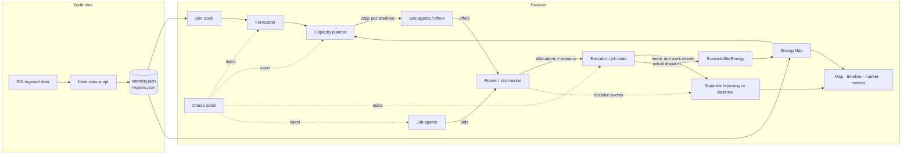

# Sunchaser: A Carbon-Aware Compute Shifter

**Status:** Draft v3 — targeted merge for team discussion · **Date:** 2026-10-27 · **Audience:** software engineers who are new to grid and energy concepts.
**Purpose:** This doc drives (a) a ~24h example implementation and (b) a slide deck. Sections marked **[Next step]** are out of scope for the 24h build.

The team's planner, hourly market, job model and demo structure remain. This merge adds Torus constraints, routing/reporting contracts and unit/accounting corrections. Algorithms, libraries, scenario sizes and estimates are team proposals, not bounty requirements. Lasso is unavailable; local Torus inputs are simulated.

---

## 1. Summary

Electricity is cleaner and cheaper in different places at different times. For example, California is solar-heavy at noon, and the Pacific Northwest runs on hydro. Many AI jobs, such as training, batch inference and evals, are flexible: they don't care *when* they run or *where*, within limits.

Sunchaser has two layers:

1. **Capacity planner (supply side).** It turns forecasts and local site availability into **hourly compute caps per site**. Torus-modeled solar, storage, protected reserves and utility commitments constrain those caps. Sites retain their regional grid context; two sites in the same region can offer different capacity.
2. **Slot market (demand side).** Site agents expose execution offers from the capacity the planner opened. Each job is an **agent** with a budget, a deadline and a carbon target, bidding for that capacity. The market clears every hour and records *why* each job won or lost. A separate executor runs the simulated allocation.

**The Torus angle:** coordinate flexible compute with locally captured energy while honoring existing utility commitments. Measure the extra benefit against the same storage assets running fixed compute; do not claim that this simulation improves on actual Lasso control.

A **responsive web app** shows a live map, the market and the carbon saved against a baseline. It also lets the viewer act as a **chaos monkey**: bust a forecast, kill a region, flood the queue or trigger a demand-response event, and then watch the system recover.

The prompt's three ideas map onto one system:

| Prompt idea | Sunchaser component |
|---|---|
| Live map of where to train right now | Map of site availability plus regional intensity and local-energy timelines |
| Job router that shows carbon saved | Router over planner/market, with a separate baseline report |
| Agents that bid for the cleanest slots | Slot market |

These are the three bounty examples chosen as deliverables. Judging: **creativity, clarity of insight and execution**. Use free/open data and label simulations.

## 2. Goals and non-goals

**Goals (24h build)**
- Use EIA regional grid evidence, starting with Utah/PacifiCorp East where applicable, plus labeled local-energy scenarios. Retain the original five-region comparison preset as an option.
- Make the simulation deterministic and replayable, with a seeded RNG and an event log.
- Show estimated carbon difference against fixed compute with the same modeled Torus assets and completed work.
- Explain every allocation: why this job, why this region, why this hour.
- Provide chaos-monkey controls whose effects are visible within seconds.
- Run as a static site that works on a phone.

**Non-goals**
- Real cluster or Torus control. The system emits caps and allocations and executes simulated jobs; no Lasso dependency or claimed hardware access.
- Real-time prices (LMP) or marginal-emissions data. These are **[Next step]**.
- Multi-tenant auth or persistence beyond the browser.

## 3. Glossary (for the non-energy reader)

| Term | Meaning |
|---|---|
| **Carbon intensity** | gCO₂ emitted per kWh consumed. Lower is cleaner. |
| **Average vs marginal intensity** | *Average* attributes emissions across electricity consumed; *marginal* estimates the emissions change from a demand change. The two can **rank hours differently** (see §8.4). |
| **Balancing Authority (BA)** | The grid operator for a region, e.g. CISO (California) or ERCO (Texas). EIA reports data per BA. |
| **Demand response (DR)** | The grid asks big consumers to cut load during stress. Flexible compute is an ideal DR resource. |
| **Flexible vs inflexible load** | Inflexible load is serving traffic and must run now. Flexible load is batch work with slack before its deadline. |
| **Slack** | Time to deadline minus minimum remaining runtime and transfer delay. Zero slack means no room to wait under that estimate; it does not override physical limits. |
| **Power / energy** | kW is a rate; kWh is energy over time. 1 MW = 1,000 kW; 1 MWh = 1,000 kWh. |
| **GPU-hour** | One GPU running for one hour. Work and allocated GPUs are different quantities. |
| **SOC / reserve** | Battery state of charge and protected stored energy, both in kWh. Only energy above the reserve can serve discretionary work. |

## 4. Architecture

Everything runs in the browser. A build-time script snapshots real data into JSON, so the demo never depends on a live API.



**Stack:** TypeScript, Vite and React, with Leaflet (or react-simple-maps) for the map and Recharts for charts. The sim engine is a pure TS module with no UI imports, so it can be unit tested and run headless for the "carbon saved" numbers on the slides. It deploys as a static site.

**Tick:** 1 sim hour per tick. The clock is adjustable from 0.5 to 5 s per tick, and the sim replays a historical 7-day window.

**Actor boundaries:** application owners supply `Job` requirements; compute operators supply hardware/queue/execution state; grid/utility inputs supply regional evidence or authorized local constraints. `RegionalGrid` adapts EIA snapshots; `SiteEnergy` answers site/time availability questions, implemented by `ScenarioSiteEnergy` for the demo. `EnergyMap` shares readings with agents and UI, initially in memory. EIA knows neither individual jobs nor available site storage.

**Integration points to settle:** assess local solar/storage supply consistently when sites share the same regional grid signal; carry the site's price evidence into `JobAgent` affordability decisions; distinguish reading/projecting availability from mutating the shared ledger on accepted execution; define when an hourly submission round closes; and normalize work, energy and comparison evidence for reporting and UI. These connections remain to implement.

## 5. Data

**Source:** EIA-930 Hourly Electric Grid Monitor. The `electricity/rto/fuel-type-data` endpoint remains useful for generation-mix context. For the reported operational-carbon comparison, use EIA's published **load/consumption CO2 intensity**, including interchange, from its BA/regional downloads. Normalize units and hour-ending timestamps to UTC. [EIA definitions and downloads](https://www.eia.gov/electricity/930-content/about.html)

`sum(generation × factor) / sum(generation)` is a generation proxy; lifecycle factors measure another boundary. Keep such exploration separately labeled, outside the operational headline. Missing evidence stays unavailable or uses a separate synthetic preset.

**Regions/sites:** start with illustrative Utah sites/PACE context where applicable. Retain the original comparison preset below. Verify service-area mappings before scoring; these are not verified Torus installations. Data determines the ranking.

| BA | Original illustrative pin |
|---|---|
| BPAT | The Dalles, OR |
| CISO | San Jose, CA |
| SWPP | Pryor, OK |
| ERCO | Dallas, TX |
| PJM | Ashburn, VA |

**Price:** a static $/MWh per region with a simple time-of-use multiplier. Real LMP data is **[Next step]**.

**Forecasts:** preserve the team's controlled sensitivity fixture, `forecast = future actual + noise`, with σ growing with horizon (e.g. 3% × √h), only as an explicitly labeled synthetic experiment. It cannot establish real predictive skill. A past-observation persistence model provides a no-future-access alternative. Each offer carries the forecast values used, source/model, issue time, valid time, scope and simulation label; missing metrics are explicit. Forecast weight can affect ranking, never physical limits. Weather-based forecasts are **[Next step]**; EIA's day-ahead demand forecast is not a carbon forecast.

**Jobs:** proposed synthetic generator with a heavy-tailed size distribution, diurnal arrivals, and roughly 70% flexible / 30% urgent jobs. Parameters remain scenario choices.

**Torus site inputs:** simulated solar, battery capacity/SOC, charge/discharge kW and efficiencies, protected reserve, fixed facility load, site power limit and hourly utility import ceiling. No real endpoint is assumed. Torus describes Pulse as sustained storage and Spin as handling fast power events; this hourly model does not simulate flywheel dynamics or claim measured Torus performance. [Pulse](https://www.torus.co/torus-nova-pulse) · [Spin](https://www.torus.co/torus-flywheel)

## 6. Core model

```ts
type RegionId = 'PACE' | 'BPAT' | 'CISO' | 'SWPP' | 'ERCO' | 'PJM';
type SiteId = string;

interface Region {
  id: RegionId;
  pricePerMWh: number;          // USD/MWh; regional context, not a site tariff claim
}

interface Site {
  id: SiteId; region: RegionId;
  gpuCapacity: number;          // total GPUs
  inflexibleLoad: number[];     // GPUs reserved per hour (serving traffic)
  powerCapMW: number;           // total site power limit; convert to kW at boundary
  kWhPerGpuHour: number;        // facility-inclusive modeled energy per GPU-hour
  energy: SiteEnergy;           // read simulated solar/storage/load/utility limits by time
}

interface EnergySlot {
  site: SiteId; hour: number; durationHours: number;
  capGpus: number;              // offered GPUs, not GPU-hours or stored energy
  reserveUsdPerGpuHour: number;
  forecast: ForecastSnapshot;   // values used + provenance, valid times and unavailable states
  sourceRevision: string;       // reject stale offers before allocation
}

interface Job {
  id: string;
  workGpuH: number;  remainingGpuH: number;
  maxGpus: number;              // parallelism limit
  arrival: number;  deadline: number;          // sim hours
  budgetUsd: number;  carbonTargetGPerKWh: number;    // preferred intensity, gCO2/kWh
  homeSite: SiteId;  allowedSites: SiteId[];          // residency/placement hard filter
  currentSite: SiteId; transferToSite?: SiteId; readyAtHour: number;
  dataGB: number;               // input size → move cost
  state: 'queued' | 'running' | 'paused' | 'moving' | 'done' | 'missed';
  log: Decision[];              // explainability
}

interface Bid { id: string; jobId: string; slot: EnergySlot }
interface BidResponse { bid: Bid } // required; abstention emits no response
interface CapacityBid { offerId: string; gpus: number; maxUsdPerGpuHour: number }
interface SiteAgent { bid(job: Job): Promise<BidResponse[]> }
interface JobAgent { bid(offers: BidResponse[]): CapacityBid[] } // bound to a job
interface Router { route(job: Job): Promise<JobOutcome> }
type JobOutcome =
  | { selected: true; selectedBid: Bid; allocatedGpus: number; clearingUsdPerGpuHour: number }
  | { selected: false; selectedBid?: never; explanation: string };
```

These are contract sketches. `Router.route` submits to the current clearing round, which collects competing submissions before resolving outcomes. Selection awards the current slot, not whole-job completion. The executor atomically revalidates/reserves before running. `ReportableJob` separately observes work/energy/decision events and derives `baselineCarbonKg - selectedCarbonKg`; routing carries no carbon-report fields.

**Energy model and units:** declare `kWhPerGpuHour` and its cooling/PUE boundary. The synthetic 0.85 assumption approximates 0.7 kW × 1.2 PUE = 0.84 kW, not measured utilization. Do not add cooling again. For a tick of `dt` hours:

```text
workGpuH = min(remainingGpuH, allocatedGpus * dt)
computeKWh = workGpuH * kWhPerGpuHour
paymentUsd = workGpuH * clearingUsdPerGpuHour
gridCarbonKg = gridImportKWh * actualGridGramsCO2PerKWh / 1000
electricityUsd = gridImportKWh * priceUsdPerMWh / 1000
```

Actual active time is `workGpuH / allocatedGpus` when allocated GPUs are nonzero; use that work for energy/payment and the full tick duration for physical energy budgets. Plans use forecasts; scoring uses realized data. In the ledger below, `fixedLoad` includes non-job facility load plus inflexible GPU energy exactly once; `compute` is admitted flexible work. Neither includes cooling already counted by another PUE-inclusive term.

**Local-energy ledger:** in bus-side kWh, `solar + gridImport + discharge = fixedLoad + compute + charge + curtailed`. Stored kWh changes by `chargeEfficiency * charge - discharge / dischargeEfficiency`. Enforce reserve ≤ SOC ≤ capacity and each power limit as kW × `dt`. Replay this ledger chronologically when projecting future caps; the same stored kWh cannot be offered independently in multiple hours.

Both runs use the same dispatch: serve fixed load, then admitted compute from solar, permitted storage and grid imports within the ceiling; charge surplus solar and curtail the rest. Initial model: no exports, grid charging or simultaneous charge/discharge. Reserve/import commitments are scenario inputs. If fixed load cannot be served within hard limits, show infeasibility.

## 7. Control loop (each sim hour)

1. **Observe.** Reveal current regional/site observations and refresh forecasts for t+1 … t+48. Keep issue time separate from the period forecast.
2. **Plan.** Every hour, recompute caps for the next 48h against the shared energy ledger. Only hour *t* is committed; future caps are conditional projections. (§8)
3. **Bid.** Site agents publish available execution offers; active job agents bid for hour-*t* offers at allowed sites. Forecast evidence travels with the offer. (§9)
4. **Clear.** Each site runs the proposed uniform-price auction up to its cap, checking current compute, energy, utility and budget limits.
5. **Execute.** Revalidate and reserve the allocation, then run for 1h; jobs checkpoint at the hour boundary. Losers wait. A job transferring cannot complete work or hold a firm executing slot until ready; it bids again on arrival. (§10)
6. **Score.** Independent observers accumulate kWh, operational CO₂, electricity cost, auction payments and deadlines for both runs, keeping those monetary measures distinct.

## 8. Deep dive: turning forecasts into capacity caps

This is the part specific to carbon-aware scheduling, and the main technical story for the deck.

### 8.1 Algorithm proposal: deadline-aware water-filling

**Inputs:**
- Forecast regional intensity `I[r,h]` plus site-local solar/storage state and provenance.
- `free[s,h] = max(0, min(gpuCapacity - inflexibleLoad[h], powerDerivedGpus))`.
- `powerDerivedGpus = floor(availableComputeKW / kWhPerGpuHour)` for the declared constant-power work model. `availableComputeKW` is what's deliverable after fixed/inflexible load, storage limits and utility constraints, capped by the remaining site power limit (`powerCapMW * 1000`). Subtract each existing load once.
- Outstanding flexible work, allowed sites, parallelism limits, transfer readiness and deadlines.

**Steps:**
1. Rank site/hour slots by estimated carbon for the modeled supply mix, including local solar/storage. Regional intensity alone cannot distinguish two Torus-modeled sites on the same grid.
2. **Deadline pass.** Open clean candidate capacity for work due before each deadline. Evaluate jobs' allowed sites, maximum GPUs and transfer-ready times against residual GPU-hours; aggregate capacity alone is insufficient. A cap of `n` GPUs for `dt` hours supplies `n * dt` GPU-hours. Replay storage feasibility whenever caps change.
3. **Carbon pass.** Prefer cleaner remaining eligible slots for outstanding work. Tentative planner placements guide caps; they are not future auction awards.
4. **Safety margin.** Extra opened capacity, e.g. `(1 + m)` with a proposed starting margin of 10%, must still fit compute, storage and utility constraints. Adjust based on observed forecast error/backlog.
5. **Damping.** Limit changes in soft caps and hour-to-hour ramps (hysteresis). A reduced physical/utility limit takes effect immediately, even if damping would hold the old cap.
6. **Reserve price.** Convert the modeled electricity component and optional carbon preference into the same USD/GPU-hour unit before adding or comparing them (§9).

This heuristic guarantees neither deadlines nor optimality. Report “no plan found by this policy”; forecasts and later auction outcomes can also invalidate projections. An LP/MILP comparison is **[Next step]**. Each greedy step maps to a pitfall for the deck.

### 8.2 Pitfalls and how the design handles them

| Pitfall | Mechanism |
|---|---|
| Forecast error leaves work undone | Receding-horizon replan every hour, plus a safety margin *m* that adapts to observed error |
| Backlog grows anyway | Relax soft carbon quotas toward physical `free[s,h]`; log the degraded mode. Never relax utility/import limits or storage reserves. |
| Starvation (a job postponed forever) | Increase urgency and relax soft carbon preferences. A deadline cannot authorize excess power, overspending or disallowed placement; show a miss when necessary. |
| Caps exceed power or contract limits | Recheck site power, shared battery inventory and accepted utility constraints before execution. |
| Herd effect (everyone piles into one site) | Site quotas and damping can reduce swings. The chaos panel can disable damping to explore this behavior; benefit is demonstrated, not assumed. |

### 8.3 Interesting nuance for the deck: the planner and the market disagree on purpose

The planner pursues lower **system carbon**; agents pursue their **own utility** within budget and deadline requirements. A carbon preference in the reserve price can connect those objectives. Preserve the `carbonPrice` slider in USD/tonne CO₂, but separate that modeled market incentive from actual electricity expenditure. It is not a utility tariff or measured carbon payment.

### 8.4 Second nuance: average vs marginal intensity

Average and marginal intensity can rank hours differently. The demo uses EIA consumption-based average operational attribution; it cannot establish which generator changes output because a job moved. A local fixture can demonstrate compute consuming solar that would otherwise be curtailed, subject to its stated assumptions. The deck calls out the distinction; a marginal signal is **[Next step]**.

## 9. Slot market: agents that bid

**Prices with explicit units:** all site offers, job bids and clearing prices use **USD/GPU-hour**. For a grid-only slot with `e = kWhPerGpuHour`:

```text
energyReserve = e * priceUsdPerMWh / 1000
carbonReserve = e * forecastGramsCO2PerKWh * carbonUsdPerTonne / 1_000_000
reserveUsdPerGpuHour = energyReserve + carbonReserve
```

At 0.85 kWh/GPU-hour, 50 USD/MWh, 500 gCO2/kWh and 100 USD/tonne, these are 0.0425 + 0.0425 = **0.085 USD/GPU-hour**. Electricity expenditure is still **0.0425**, not 0.085. Local-energy offers use the modeled source mix/losses rather than treating all work as grid-powered. Unknown carbon is not a zero-carbon offer.

**Agent bid for site slot (s, t):**
```
urgency   = remainingGpuH / (maxGpus × hoursAvailableAfterTransfer) // dimensionless; >1 is at risk
value     = baseValue × (1 + k × urgency²)                       // bids rise as deadline nears
affordable = min(value, budgetForComputeUsd / remainingGpuH)     // USD/GPU-hour, after transfer cost
carbonOK  = forecastSlotGPerKWh ≤ carbonTargetGPerKWh || urgency > 0.8
bid       = readyAtSite(s) && eligible && carbonOK && affordable >= reserveUsdPerGpuHour ? affordable : none
```

Guard zero work/time before dividing. No bid means no `CapacityBid`/`BidResponse`. Check the budget-capped bid against the reserve. Budget covers modeled market payments; electricity cost is reported separately.

Each ready agent requests `min(maxGpus, ceil(remainingGpuH / tickHours))` GPUs at one eligible site; one bid per round prevents duplicate awards. Complete at most `min(remainingGpuH, allocatedGpus * tickHours)` work and charge that run duration. Recheck budget each award; affordability at current prices does not guarantee later execution.

**Clearing proposal:** each site sorts eligible bids by price with deterministic ties and fills `cap[s,t]`, respecting each job's GPU limit and the shared energy ledger. For homogeneous GPU units with a common site/hour reserve, use the greater of that reserve and the highest rejected unit bid, or the reserve if there is no rejected unit. Payment is `clearingUsdPerGpuHour * allocatedGpuHours`. Support partial allocations explicitly; verify clearing price never exceeds a winner's bid. Multi-unit uniform-price auctions are not generally truthful. More elaborate pricing remains a team choice, not a bounty requirement.

**Explainability:** every decision appends a `Decision` record to the job's log, for example:
`t=31 site-A: skipped (forecast 540 > target 300 gCO2/kWh, urgency 0.2)` or `t=34 site-B: won 8 GPU-hours @ 0.085 USD/GPU-hour; payment 0.68 USD`. Include evidence revision, protected-energy or budget rejection reasons. The UI shows these logs.

## 10. Cross-region moves (lightweight)

- **Move energy/time:** `transferKWh = dataGB * kWhPerGB`; `transferHours = dataGB / bandwidthGBPerHour`. Coefficients are labeled assumptions. With hourly scheduling, become ready at the first tick boundary at or after transfer completes. During transfer, no compute work completes.
- **Transfer trigger:** the agent's move decision starts transfer before destination bidding, records the target/ready time, pays the transfer cost and enters `moving`. It needs no execution award to start moving. On arrival, update `currentSite` and bid there; being ready at the origin does not make the job ready at the destination.
- **Move decision:** compare forecast carbon saved with `transferCarbonKg = transferKWh * transferGramsCO2PerKWh / 1000`, using a declared network/source accounting boundary. Include monetary transfer cost in available budget. Require time for transfer plus `remainingGpuH / maxGpus` before the deadline and check eligible capacity; this is a necessary screen, not a completion guarantee. A moving job bids again when ready and may still wait or miss. Carbon with unknown evidence remains unavailable.
- **Data residency:** `allowedSites` is a hard filter; regional policies can resolve to allowed sites. Some generated jobs are pinned.
- **Herd effect:** handled by caps and damping (§8.2).

## 11. Job lifecycle

```
queued → running ⇄ paused → done
            ↓ ↑
          moving            (any) → missed  (deadline passed)
```
- Jobs checkpoint at every hour boundary with zero overhead in this explicitly simplified model. Non-checkpointable jobs that need contiguous runs are **[Next step]**.
- Work is accounted per job-hour with an idempotent key `(jobId, hour)`, so replays and preemptions can't double-count.
- **Lateness view:** every job shows its slack, its projected finish time and the carbon it has used. This answers "how late is my job, and why?"
- Stop unfinished jobs at their deadline and mark them missed. Replaying the same tick cannot charge work, money or transfer energy twice.

## 12. Chaos monkey

Each control injects an event, and the UI highlights the system's response.

| Chaos control | What it does | Expected response |
|---|---|---|
| **Forecast bust** | Actual intensity in region R is +40% for 6h ("wind died") | Next replan shifts caps away from R. *m* grows. Some carbon is lost, which is shown. |
| **Site/region outage** | Capacity drops to 0 | Agents can move and re-bid after transfer. Pinned jobs wait, may miss deadlines, and are flagged. |
| **Utility event** | Tighten accepted import ceiling or raise protected reserve | Revalidate energy availability immediately; work shifts or waits. Show import/commitment compliance, not unverified "DR MWh delivered." |
| **Local solar change** | Reduce realized solar at a Torus-modeled site | Update storage/import dispatch and usable compute capacity; show forecast versus realized energy. |
| **Job flood** | 50 urgent jobs arrive | Backlog fallback relaxes caps. The carbon cost of urgency is visible. |
| **Stale data feed** | Forecast stops updating | Planner holds the last forecast and widens *m*. A "degraded" badge appears. |
| **Deadline crunch** | Halves all remaining deadlines | Urgency rises; soft carbon preferences may relax. Hard constraints remain; show missed work and cost/carbon effects. |
| **Damping off** | Disables hysteresis and quotas | Herd oscillation becomes visible on the timeline. |
| **Carbon price slider** | $0 → $300/tCO₂ | Cost-vs-carbon trade-off, live |

Chaos events go into the seeded event log, so "replay this run" reproduces the same result.

These controls are the team's demo menu, not additional bounty requirements. Prioritize enough to show the chosen story. If an event makes fixed facility load physically unserviceable, show an infeasible scenario and suppress savings claims.

An immediately effective reserve cannot exceed current SOC; reject that setting as infeasible. A future reserve needs a feasible projected charging path before its effective time. Neither control can create stored energy or silently report compliance.

## 13. Metrics and baseline

**Baseline:** the same job stream, run **as soon as possible at the home site** (FIFO, without discretionary carbon quotas or moves). Both runs use the same Torus-modeled assets, initial state, weather, prices, utility constraints, physical limits and dispatch policy. Fixed scheduling still respects all hard limits.

**Accounting:** use the fleet-wide meter ledger, not just a moved job's allocation. Count imported electricity and declared transfer energy once; do not count battery discharge again. Solar has zero direct operational CO2 in this model; lifecycle impacts are excluded. Start from empty batteries with a common warm-up if reserve is needed. Include inflexible/idle facility energy through declared inputs; powering another site cannot silently erase existing consumption.

At a common horizon, headline savings require the same jobs fully completed and matching per-site ending storage within a declared tolerance. Otherwise show raw totals, incomplete work and non-comparability. Negative savings remain visible; percentages are unavailable when baseline is zero. `ReportableJob` derives carbon reduction from its compatible baseline/selected evidence; unknown is never zero.

**Research coverage limits:** the home-site baseline does not compare against the best fixed placement. Forecast sensitivity remains proposed, with no demonstrated robustness to uncertainty. This draft distinguishes average from marginal attribution and includes declared fleet idle energy, but the current acceptance cases do not test marginal-ranking reversals or idle-fleet tradeoffs. Water use and carbon/water tradeoffs are outside the current model. The initial tests cover selected examples, not every research counterexample.

**Headline tiles:**
- **Estimated operational CO₂ difference** (kg and %, when comparable)
- **Electricity energy-charge delta**, separate from modeled auction payments/carbon incentives
- **Deadline misses** (Sunchaser vs baseline)
- **Avg delay** per job
- **Local solar used / curtailed**, plus regional intensity context
- **Grid imports, peak hourly-average import kW and commitment compliance**; no assumed demand-charge savings or utility revenue

**Planned headless command:** `npm run sim -- --seed 1 --days 7` prints the headline numbers for the slides. This is an intended interface, not an existing executable. Export scenario/seed, data window, policy settings and baseline with results; use the same engine as the UI.

## 14. UI (responsive)

- **Map:** site pins colored by the chosen energy/carbon signal, sized by running GPUs, with regional context. Arrows show transfers. Distinguish current, forecast, stale and simulated evidence; stale observations cannot masquerade as executable offers.
- **Timeline:** regional intensity and local solar/storage/reserves, forecast versus actual, overlaid with caps and usage. This is the key chart for the planner story.
- **Market panel:** site offers, job bids and the clearing price per site/hour. Clicking a job opens its decision log.
- **Metrics tiles:** Sunchaser vs baseline.
- **Chaos drawer:** buttons and sliders. On mobile, the layout stacks as map → tiles → chaos → timeline.

## 15. 24h build plan

Original team estimate for discussion, not assigned work. Torus ledger integration adds work to blocks 2–3; re-estimate together.

| # | Block | Est. | Cut line |
|---|---|---|---|
| 1 | Data fetch script, intensity normalization, JSON snapshot | 2h | Must |
| 2 | Sim core: clock, sites/energy ledger, job generator, executor, baseline, observers | 4h | Must |
| 3 | Planner: water-filling, eligibility/deadline checks, Torus limits, margin, damping | 3h | Must |
| 4 | Market: bids, clearing, decision log | 3h | Must |
| 5 | UI shell, map, metrics tiles, timeline | 4h | Must |
| 6 | Chaos controls: bust, outage, DR, flood | 2h | Must |
| 7 | Market panel, job log, move arrows | 2h | Should |
| 8 | Stale feed, deadline crunch, damping toggle, carbon-price slider | 1.5h | Should |
| 9 | Headless runner and slide numbers | 1h | Should |
| 10 | Deploy and polish | 1.5h | Must |

The original estimates total about 24h; the merged scope needs the team's check. If time runs short, cut polish and extra controls first. A simpler clearing policy is an option, but keep observable site offers/job bids, routing, map and separate reporting so all three chosen bounty capabilities remain demonstrable.

## 16. Next steps (for the deck)

1. Marginal emissions signal (WattTime) and real LMP prices
2. Weather-based forecasts from Open-Meteo plus installed capacity; EIA day-ahead demand as a separate input, not a carbon forecast
3. LP/MILP planner compared with the greedy heuristic under explicit feasibility assumptions
4. Non-checkpointable and gang-scheduled jobs, plus richer data-gravity modeling
5. Integration with a real scheduler (Kubernetes / Slurm) as an admission controller that enforces caps
6. Fleet DR participation: bidding flexible compute into grid DR programs as a revenue source
7. Global regions, e.g. via Electricity Maps, for true follow-the-sun across time zones
8. Authorized real site telemetry/control adapter to replace `ScenarioSiteEnergy`; no assumed Lasso access

**Deck flow:** open with the demo, show why Torus's local energy and commitments change a decision, explain planner/market interaction, then show comparable headless results and limitations. Preserve the architecture diagram, timeline, cost/carbon trade-off and forecast-sensitivity example. Use the same solar/utility perturbation as the UI; label simulations and the average-versus-marginal distinction. Keep this future-work list separate from demonstrated capabilities. Screenshots or a recorded replay can back up the live demo.

## 17. Risks and open questions

- **EIA data gaps.** Pick and validate a usable window. Flag missing evidence; do not silently interpolate scoring data or present a generation proxy as consumed operational CO2.
- **Synthetic forecasts and synthetic jobs** could make savings look better than reality. Plan: state this on the slides, and show a sensitivity check with forecast noise increased.
- **Open question:** should the deck lead with the planner (technical depth) or the chaos demo (engagement)? Suggestion: open with the demo, then go deep on the planner.
- **Team choices:** horizon, job/site counts, market mechanism, migration depth and control priorities remain open. The merge does not mandate the earlier three-site/eight-job/one-GPU restriction, posted prices or whole-job reservations.

## 18. Highest-value acceptance examples

Seven generated core acceptance cases and three enabled browser userflows now form the initial acceptance harness. Their unimplemented drivers keep feature requirements RED. The internal score covers this initial set; it does not establish planner feasibility, concurrent clearing/reservation safety or migration correctness. The examples below remain design sketches. Helpers arrange inputs and inspect the real router/executor/report; they must not implement a second scheduler. Unspecified fixture constraints are compatible and budgets are sufficient.

```ts
it("routes work to otherwise-curtailed solar and reports the increment", async () => {
  await demo.sites({
    A: { solarKWh: 0, batteryCapacityKWh: 0 },
    B: { solarKWh: 2, batteryCapacityKWh: 1 },
    gridGramsCO2PerKWh: 400, initialStoredKWh: 0, efficiency: 1,
    gpuCount: 1, fixedLoadKWh: 0, protectedKWh: 0,
    gridImportLimitKW: 2, facilityPowerLimitKW: 2,
    chargeLimitKW: 1, dischargeLimitKW: 1, transfer: { hours: 0, kWh: 0 }
  });
  await demo.job({ home: "A", allowed: ["A", "B"], hours: 1, deadline: 1, kWhPerHour: 1 });
  await demo.compareRuns({ preference: "lowestCarbon" });
  await demo.expectBothCompleteJobs(1);
  await demo.expectEndingStorage({ A: 0, B: 1 }, "both");
  await demo.expectCarbonKg({ baseline: 0.4, selected: 0, reduction: 0.4 });
});

it("a site cannot sell energy protected for the utility", async () => {
  await demo.siteEnergy({
    site: "A", storedKWh: 4, batteryCapacityKWh: 6, protectedKWh: 4,
    efficiency: 1, solarKWh: 0, gridLimitKW: 0
  }); // no stored energy is available to compute this hour
  await demo.job({ allowed: ["A"], hours: 4, deadline: 4, kWhPerHour: 1 });
  await demo.route();
  await demo.expectNoSiteBid("A");
  await demo.expectSelected(false);
});

it("the map distinguishes current offers from stale evidence", async () => {
  await demo.siteObservedAt("A", "12:00");
  await demo.siteObservedAt("B", "12:05");
  await demo.readMap({ now: "12:06", maximumAgeMinutes: 5 });
  await demo.expectMapState("A", "stale");
  await demo.expectMapState("B", "current");
});

it("a job declines capacity it cannot afford", async () => {
  await demo.siteOffer({ site: "A", askUsdPerGpuHour: 1 });
  await demo.job({ allowed: ["A"], hours: 1, deadline: 1, budgetUsd: 0.5 });
  await demo.route();
  await demo.expectSiteBid("A");
  await demo.expectNoCapacityBid();
  await demo.expectSelected(false);
});
```

Fixture efficiencies and quantities above are synthetic. Carry these small counterexamples into the same acceptance layer: two jobs pinned to one single-GPU site, each needing four GPU-hours before a four-hour deadline; an urgent job blocked by a utility ceiling; a one-hour transfer leaving no time for a one-hour job; two jobs competing for one stored-energy budget; and unequal completed work suppressing headline savings.
